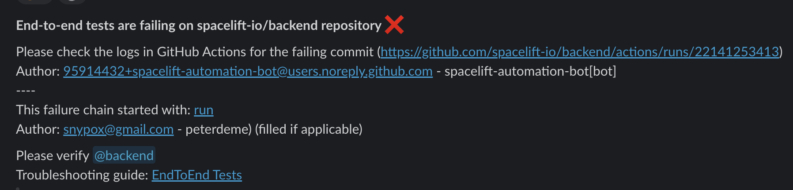

# Notify Workflow Failure

A GitHub Action that sends Slack notifications when a workflow fails, providing detailed information about both the current failure and the commit that initially broke the build.

## Features

- Looks up and mentions Slack users by email from GitHub commit authors
- Identifies the commit author of the current failed run
- Tracks the first failed commit after the last successful run
- Provides direct links to both the current and initial failed workflow runs
- Detects bot commits and optionally mentions a usergroup for verification
- Includes a link to troubleshooting documentation
- Sanitizes dependabot email addresses for Slack compatibility

## Usage

Add this action to your workflow's failure handling section.

The job running this action requires the following permissions:

- `contents: read` — to read commit history and identify the first failing commit after the last successful run
- `actions: read` — to query past workflow runs via the GitHub API

```yaml
name: Your Workflow

on:
  push:
    branches: [main]

jobs:
  build:
    permissions:
      contents: read
      actions: read
      
    runs-on: ubuntu-latest
    steps:
      - name: Your build steps
        run: echo "Build and test..."

      - name: Notify on failure
        if: failure()
        uses: spacelift-io/shared-actions/actions/notify-workflow-failure@main
        with:
          github_token: ${{ secrets.GITHUB_TOKEN }}
          slack_bot_token: ${{ secrets.SLACK_BOT_TOKEN }}
          slack_channel_id: ${{ secrets.SLACK_CHANNEL_ID }}
          slack_usergroup_name: 'backend'  # Optional: for bot failures
          troubleshooting_guide_url: 'https://your-docs.com/guide'  # Optional: customize URL
```

## Inputs

| Input | Description | Required | Default          |
|-------|-------------|----------|------------------|
| `github_token` | GitHub token for API access (use `${{ secrets.GITHUB_TOKEN }}`) | Yes | -                |
| `slack_bot_token` | Slack Bot OAuth Token for API access | Yes | -                |
| `slack_channel_id` | Slack channel ID to send notifications to | Yes | -                |
| `slack_usergroup_name` | Slack usergroup name to mention for bot failures (e.g., "backend") | No | `backend`        |
| `workflow_name` | Name of the workflow to track | No | Current workflow |
| `ref` | Git ref/branch to track | No | Current ref      |
| `header_message` | Custom header message in the Slack notification | No | -                |
| `troubleshooting_guide_url` | URL to the troubleshooting guide | No | -                |

## Slack Notification Format

The action sends a message to Slack as follows:



## Setting Up Slack Integration

### Prerequisites

1. **Create a Slack App** (or use an existing one)
   - Visit https://api.slack.com/apps
   - Create a new app or select an existing one

2. **Configure OAuth Scopes**
   - Navigate to "OAuth & Permissions"
   - Add the following Bot Token Scopes:
     - `chat:write`
     - `users:read.email`
     - `usergroups:read`
     - `users:read`
     - `users:read.email`

3. **Install App to Workspace**
   - Install the app to your Slack workspace
   - Copy the "Bot User OAuth Token" (starts with `xoxb-`)

4. **Get Channel ID**
   - Right-click on your target Slack channel
   - Select "View channel details"
   - Copy the Channel ID from the bottom of the modal

5. **Add Secrets to GitHub**
   - `SLACK_BOT_TOKEN`: Your bot OAuth token
   - `SLACK_CHANNEL_ID`: Your target channel ID
